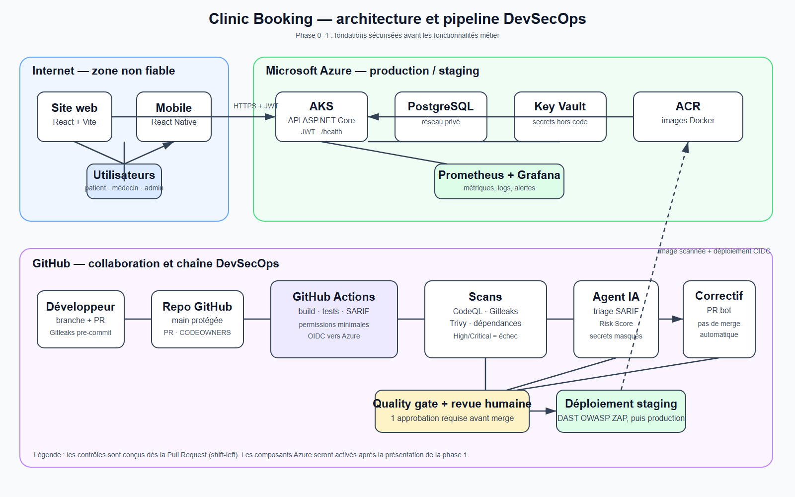

# Schéma d’architecture

Le schéma ci-dessous est le support de la présentation de la phase 0–1. Il sépare les trois frontières de confiance : Internet, GitHub et Azure.

Le fichier [`architecture-overview.png`](architecture-overview.png) est prêt pour les slides ; le fichier SVG associé reste la source modifiable.

## Lecture rapide pour la présentation

1. Les utilisateurs emploient le site React ou l’application React Native. Les deux clients communiquent seulement en HTTPS avec l’API ASP.NET Core et un JWT.
2. Dans Azure, l’API sera déployée sur AKS. PostgreSQL reste dans un réseau privé ; Key Vault fournit les secrets sans les stocker dans le code ; ACR conserve l’image Docker.
3. Chaque changement passe par une Pull Request. GitHub Actions construit, teste et scanne le code avec CodeQL, Gitleaks et Trivy. Une vulnérabilité High/Critical ou un secret bloque le merge.
4. Après le quality gate et une revue humaine, la pipeline déploiera vers le staging. OWASP ZAP exécutera alors le DAST avant la production.

## Contrôles visibles sur le schéma

| Risque | Contrôle montré | Preuve à conserver |
|---|---|---|
| Secret poussé dans le dépôt | Gitleaks pre-commit, push protection et scan CI | Capture du push bloqué ou de la pipeline rouge |
| Code vulnérable | CodeQL, Trivy et quality gate | Exécution GitHub Actions et résultat Security |
| Accès Azure compromis | OIDC et Key Vault, sans secret dans GitHub | Configuration du déploiement quand Azure sera activé |
| Déploiement non revu | PR, une approbation et quality gate | Historique de Pull Request |

> Le déploiement Azure, l’agent IA, la remédiation et le DAST sont dessinés pour montrer la cible d’architecture. Ils ne sont pas des prérequis pour la démo de mercredi.
