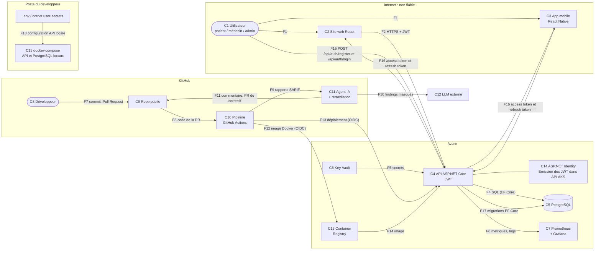

# Threat model v1.1 : application de prise de rendez-vous en clinique

| | |
|---|---|
| **Version** | v1.1 (semaine 2 : authentification JWT et base PostgreSQL). La v2 sera faite avant le rapport. |
| **Méthode** | STRIDE, par composant et par flux de données |
| **Pilote** | Mohammed EL OMRI, avec toute l'équipe |
| **Périmètre** | L'application (web, mobile, API, base), la pipeline GitHub Actions et l'hébergement Azure |

## Historique

| Version | Date | Changement |
|---|---|---|
| v1 | 12 octobre 2026 | Cadrage initial, composants C1–C13, flux F1–F14 et menaces T1–T10 |
| v1.1 | 20 octobre 2026 | Authentification JWT et PostgreSQL : C14–C15, F15–F18, T11–T19 et couverture actualisée |

> **Hypothèse :** l'application est la prise de rendez-vous en clinique, avec les rôles
> patient / médecin / admin. Si l'équipe change d'idée, seules les menaces T1 et T5 changent
> d'exemple : les composants et les flux restent les mêmes.

## 1. Ce qu'on protège

| Actif | Pourquoi c'est sensible |
|---|---|
| Rendez-vous et données des patients | Données de santé : un patient ne doit voir que les siennes |
| Comptes et tokens (JWT, refresh token) | Voler un token = se faire passer pour quelqu'un |
| Secrets (mot de passe de la base, clé de signature JWT) | Donnent accès à toutes les données |
| La pipeline et son accès à Azure | Celui qui contrôle la pipeline contrôle la production |
| Le code sur `main` | C'est ce qui est déployé automatiquement |

## 2. Composants

| # | Composant | Rôle | Zone de confiance |
|---|---|---|---|
| C1 | Utilisateur (patient, médecin, admin) | Utilise l'application | Internet (non fiable) |
| C2 | Site web React | Interface dans le navigateur | Internet (non fiable) |
| C3 | Application mobile React Native | Interface sur le téléphone | Internet (non fiable) |
| C4 | API ASP.NET Core | Authentification JWT, règles métier | Azure (AKS) |
| C5 | Base PostgreSQL | Utilisateurs (hash des mots de passe), refresh tokens, créneaux, rendez-vous | Azure (réseau privé) |
| C6 | Key Vault | Secrets de l'API | Azure |
| C7 | Prometheus + Grafana | Métriques, logs, alertes | Azure (AKS) |
| C8 | Développeur | Pousse du code via Pull Request | GitHub |
| C9 | Repo GitHub (public) | Code, historique, rapports de sécurité | GitHub |
| C10 | Pipeline GitHub Actions | Build, tests, scans, quality gate, déploiement | GitHub |
| C11 | Agent IA + remédiation | Trie les rapports SARIF, propose des correctifs | GitHub |
| C12 | LLM externe (Gemini) | Analyse les findings envoyés par l'agent | Tiers (non fiable) |
| C13 | Azure Container Registry | Stocke l'image Docker de l'API | Azure |
| C14 | ASP.NET Identity + émission des JWT | Authentification dans l’API | Azure (AKS) |
| C15 | docker-compose local | API + PostgreSQL de développement | Poste du développeur |

## 3. Diagramme de flux de données

Les cadres sont les **frontières de confiance** : chaque flèche qui traverse un cadre est un
endroit où une attaque peut arriver.

Le même diagramme en image, pour les slides ou si l'aperçu ci-dessus ne s'affiche pas :
[`threat-model-v1-dfd.png`](threat-model-v1-dfd.png).

## 4. Flux de données

| Flux | De → vers | Données | Protection prévue |
|---|---|---|---|
| F1 | Utilisateur → web / mobile | Identifiants, données de rendez-vous | Validation des entrées |
| F2 | Web → API | Requêtes + JWT | HTTPS + HSTS, CORS limité au site, token en mémoire |
| F3 | Mobile → API | Requêtes + JWT | HTTPS uniquement, token dans expo-secure-store |
| F4 | API → PostgreSQL | Requêtes SQL | EF Core paramétré, base non publique |
| F5 | Key Vault → API | Mot de passe de la base, clé JWT | Aucun secret dans le code ni dans l'image |
| F6 | API → monitoring | Métriques, logs | Serilog sans données sensibles |
| F7 | Développeur → repo | Code | Gitleaks pre-commit, push protection, PR obligatoire |
| F8 | Repo → pipeline | Code de la PR (non fiable) | `permissions:` minimal, pas de `pull_request_target` |
| F9 | Pipeline → agent IA | Rapports SARIF | Contenu traité comme non fiable |
| F10 | Agent IA → LLM | Findings | Secrets masqués, jamais de finding Gitleaks |
| F11 | Agent IA → repo | Commentaire, PR de correctif | Sortie validée, jamais de merge automatique |
| F12 | Pipeline → ACR | Image Docker | OIDC, scan Trivy de l'image avant le push |
| F13 | Pipeline → AKS | Déploiement | OIDC, seulement si la quality gate passe |
| F14 | ACR → AKS | Image Docker | Image minimale, utilisateur non-root |
| F15 | Utilisateur → API (C14) | `POST /api/auth/register` et `/api/auth/login` : email, mot de passe | HTTPS, DTOs, validation, rate limiting |
| F16 | API → client web / mobile | Access token + refresh token | HTTPS, access token court, refresh token haché et rotation |
| F17 | API → PostgreSQL | Migrations EF Core (schéma) | Compte de migration séparé, TLS sur Azure |
| F18 | `.env` / `dotnet user-secrets` → API en local (C15) | Chaîne de connexion, clé JWT | `.env` ignoré par Git, `.env.example` sans valeur |

## 5. Les menaces (STRIDE)

| ID | Menace | STRIDE | Catégorie OWASP | Contrôle prévu | Outil qui la détecte |
|---|---|---|---|---|---|
| T1 | Un patient change l'identifiant dans l'URL et lit ou annule le rendez-vous d'un **autre patient** (F2, F3) | Elevation of Privilege | API1:2023 Broken Object Level Authorization · A01:2025 Broken Access Control | Chaque endpoint vérifie que la ressource appartient à l'utilisateur du JWT | Tests xUnit (403) + OWASP ZAP |
| T2 | Un **secret est commité** dans le repo public : mot de passe de la base, clé JWT, chaîne de connexion dans `appsettings.json`, `docker-compose.yml` ou un `.env` commité (F7, F18) | Information Disclosure | A02:2025 Security Misconfiguration · A04:2025 Cryptographic Failures | `dotnet user-secrets` en local, Key Vault sur Azure, OIDC sans clé stockée, `.env` dans `.gitignore` + `.env.example` sans valeur | Gitleaks (pre-commit + pipeline), push protection, secret scanning, Trivy |
| T3 | Un attaquant **se fait passer pour un utilisateur** : essais de mots de passe en masse, JWT expiré ou falsifié (F2, F3) ; voir aussi T11, T12, T14 | Spoofing | API2:2023 Broken Authentication · A07:2025 Authentication Failures | ASP.NET Identity (verrouillage du compte), access token court + refresh token, vérification de la signature et de l'expiration | Tests xUnit (401) + OWASP ZAP + CodeQL |
| T4 | **Injection SQL** dans la recherche de rendez-vous : `FromSqlRaw` / `ExecuteSqlRaw` concaténés avec une entrée utilisateur (F4) | Tampering | A05:2025 Injection | LINQ ou `FromSql` (interpolation paramétrée), DTOs + validation ; remédiation automatique v2 (Abdedaym) | CodeQL + Semgrep + OWASP ZAP |
| T5 | Un patient appelle un endpoint réservé au **médecin ou à l'admin** (attribution du rôle à l’inscription : voir T13) (F2, F3) | Elevation of Privilege | API5:2023 Broken Function Level Authorization · API3:2023 Broken Object Property Level Authorization | `[Authorize]` + politiques par rôle, DTOs sans champ `role` | Tests xUnit (403) + Semgrep (`[Authorize]` manquant) + OWASP ZAP |
| T6 | Un robot **inonde l'API** (login, prise de rendez-vous) et la rend indisponible, ou réserve tous les créneaux (F2, F3) | Denial of Service | API4:2023 Unrestricted Resource Consumption · API6:2023 Unrestricted Access to Sensitive Business Flows | Rate limiting, pagination, requests/limits Kubernetes | Tests xUnit (429) + alerte Grafana sur les pics de 429 + Checkov (limits) |
| T7 | Une **dépendance vulnérable** ou une action GitHub compromise s'exécute dans l'API ou dans la pipeline, qui a accès au déploiement Azure (F8, F12, F13) | Tampering | A03:2025 Software Supply Chain Failures | Dependabot, actions épinglées par SHA, `permissions:` minimal, image minimale | Trivy (fs + image), `dotnet list package --vulnerable`, npm audit, Dependabot, CodeQL (workflows) |
| T8 | Une action sensible (annulation d'un rendez-vous, changement de rôle, connexions échouées) **n'est pas tracée** : l'auteur peut nier et l'attaque passe inaperçue (F6) | Repudiation | A09:2025 Security Logging and Alerting Failures | Logs Serilog structurés (qui, quoi, quand, sans donnée sensible), alertes | Alertes Prometheus + Grafana (pics de 401/403) + revue de code |
| T9 | Le **token est volé sur le client** : stocké dans AsyncStorage (mobile) ou localStorage (web), ou envoyé en HTTP (F2, F3) | Information Disclosure | M9:2024 Insecure Data Storage · M5:2024 Insecure Communication | expo-secure-store, token web en mémoire, HTTPS uniquement, Content-Security-Policy | MobSF (APK) + Semgrep / eslint-plugin-security + OWASP ZAP (en-têtes) |
| T10 | **Prompt injection** : un commentaire dans le code de la PR dit à l'agent IA de classer une vraie faille en faux positif, ou de révéler un secret (F9, F10, F11) | Tampering | LLM01:2025 Prompt Injection · LLM05:2025 Improper Output Handling · LLM02:2025 Sensitive Information Disclosure | Contenu traité comme non fiable, sortie JSON validée par un schéma, rien n'est exécuté, secrets masqués, **quality gate indépendante de l'IA**, jamais de merge automatique | Tests unitaires de l'agent (cas d'injection) + quality gate + revue humaine des PR du bot |
| T11 | **JWT falsifié** : clé de signature faible ou commitée, `alg: none` accepté, validation désactivée (`ValidateIssuer/Audience/Lifetime = false`, `ClockSkew` trop grand) (F2, F3, F16) | Spoofing | API2:2023 · A07:2025 · A04:2025 | Clé ≥ 256 bits dans user-secrets / Key Vault, `TokenValidationParameters` strict (émetteur, audience, durée, signature), algorithme imposé (HS256), `ClockSkew` court | Tests xUnit 401 (token signé avec une autre clé, expiré, `alg: none`) + Semgrep (validation désactivée) + Gitleaks (clé) |
| T12 | **Refresh token volé ou réutilisé** pour garder l'accès indéfiniment (F16) | Spoofing | API2:2023 · A07:2025 | Refresh token stocké **haché** en base, rotation à chaque utilisation, révocation à la déconnexion, durée limitée, réutilisation détectée → tous les tokens de l'utilisateur révoqués | Tests xUnit (refresh réutilisé → 401) |
| T13 | **Rôle Admin à l'inscription** : le client ajoute `"role": "Admin"` dans le corps de `POST /api/auth/register` (mass assignment) (F15) | Elevation of Privilege | API3:2023 · A01:2025 | DTO d'inscription **sans champ rôle**, rôle `Patient` imposé côté serveur, comptes Doctor/Admin créés seulement par un admin ou par le seed | Test xUnit (inscription avec `role=Admin` → compte Patient) + Semgrep |
| T14 | **Énumération des comptes** : message ou temps de réponse différent entre « email inconnu » et « mauvais mot de passe » (F15) | Information Disclosure | API2:2023 · A07:2025 | Message générique et même code (401) dans les deux cas, rate limiting sur `/api/auth/*` | Test xUnit (deux réponses identiques) + OWASP ZAP |
| T15 | **Mots de passe faibles ou mal stockés** : mot de passe trivial accepté, hachage maison (F15, F4) | Information Disclosure | A07:2025 · A04:2025 | `PasswordHasher` d'ASP.NET Identity (PBKDF2), politique de mot de passe, verrouillage après plusieurs échecs | Test xUnit (mot de passe faible → 400) + revue de code |
| T16 | **Token ou mot de passe dans les logs** : Serilog enregistre l'en-tête `Authorization` ou le corps de `/api/auth/login` (F6) | Information Disclosure | A09:2025 | Pas de corps de requête ni d'en-tête `Authorization` dans les logs, filtres Serilog | Revue de code + Semgrep + vérification des logs dans Grafana |
| T17 | **Base PostgreSQL exposée** : accès public Azure ouvert, règle de pare-feu `0.0.0.0`, port 5432 publié par docker-compose (C5, C15) | Information Disclosure | A02:2025 · API8:2023 | Azure Flexible Server en accès privé (VNet), aucune IP publique, port 5432 non publié en local hors `127.0.0.1` | Checkov (Terraform) + revue du docker-compose |
| T18 | **Compte base trop puissant** : l'API se connecte avec le compte propriétaire / superuser (C4 → C5) | Elevation of Privilege | A02:2025 · A01:2025 | Utilisateur applicatif limité aux lectures/écritures, migrations avec un compte séparé | Revue de code + Checkov (partiel) |
| T19 | **Connexion API → base non chiffrée** (`SSL Mode=Disable`) : interception des données de santé (F4) | Information Disclosure | A04:2025 | `SSL Mode=Require` (ou `VerifyFull`) sur Azure, TLS imposé côté serveur | Checkov (TLS imposé) + revue de la configuration |

### Couverture

| Catégorie STRIDE | Menaces |
|---|---|
| **S**poofing | T3, T11, T12 |
| **T**ampering | T4, T7, T10 |
| **R**epudiation | T8 |
| **I**nformation Disclosure | T2, T9, T14, T15, T16, T17, T19 |
| **D**enial of Service | T6 |
| **E**levation of Privilege | T1, T5, T13, T18 |

| Référentiel OWASP | Menaces |
|---|---|
| Top 10:2025 | T1, T2, T3, T4, T7, T8, T11, T12, T13, T14, T15, T16, T17, T18, T19 |
| API Security Top 10 (2023) | T1, T3, T5, T6, T11, T12, T13, T14, T17 |
| Mobile Top 10 (2024) | T9 |
| Top 10 for LLM Applications (2025) | T10 |

## 6. Où en est-on aujourd'hui ?

La pipeline existe déjà : certaines menaces sont détectées dès maintenant, les autres le seront
quand le composant concerné existera.

| Menace | Détectée aujourd'hui ? | Ce qui manque |
|---|---|---|
| T2 secret commité | **Oui** : Gitleaks, Trivy, push protection | Rien (démo de mercredi) |
| T7 dépendance vulnérable | **Oui** : Trivy, Dependabot, CodeQL sur les workflows | npm audit quand `/web` et `/mobile` existeront |
| T4 injection SQL | En partie : CodeQL C# s'active dès qu'il y a du code C# | Semgrep, puis ZAP sur le staging |
| T1, T3, T5, T6 | Non | Les endpoints et les tests xUnit de sécurité (phase 2) |
| T8 | Non | Serilog + monitoring (phase 5) |
| T9 | Non | Web, mobile, MobSF (phases 2 et 3) |
| T10 | Non | L'agent IA et ses tests (phase 4) |
| T11–T16 | Non | En attente du login JWT de Freddy, tests 401/403/400 d’Abdedaym |
| T17–T19 | Non | En attente du Terraform et du docker-compose d’Ali, Checkov à ajouter par Hajar |

## 7. À traiter dans la v2

- Pull Request malveillante qui modifie un workflow pour voler l'accès à Azure.
- Infrastructure mal configurée : conteneur root (Checkov, Trivy config).
- Messages d'erreur trop bavards, Swagger exposé en production (A10:2025, API8:2023).
- PR de correctif générée par l'IA qui introduit une régression (LLM06:2025 Excessive Agency).
- Refaire le diagramme dans OWASP Threat Dragon et l'exporter en PNG dans `/docs`.
- Ajouter pour chaque menace la preuve gardée pour le rapport (capture, lien vers la PR).
- Vérifier T11–T19 contre le vrai code de Freddy et d’Ali.
